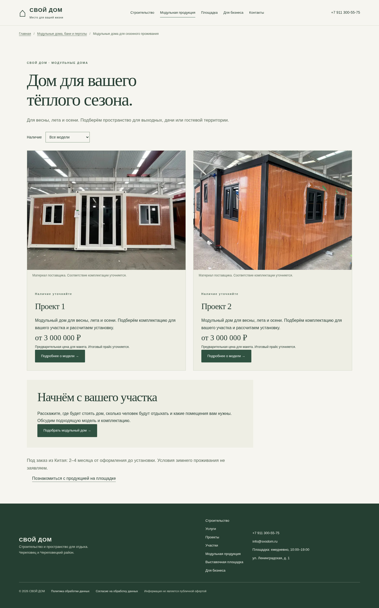
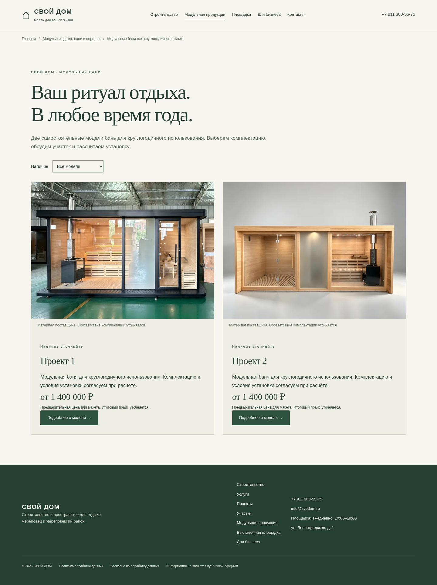
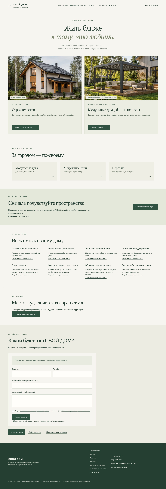
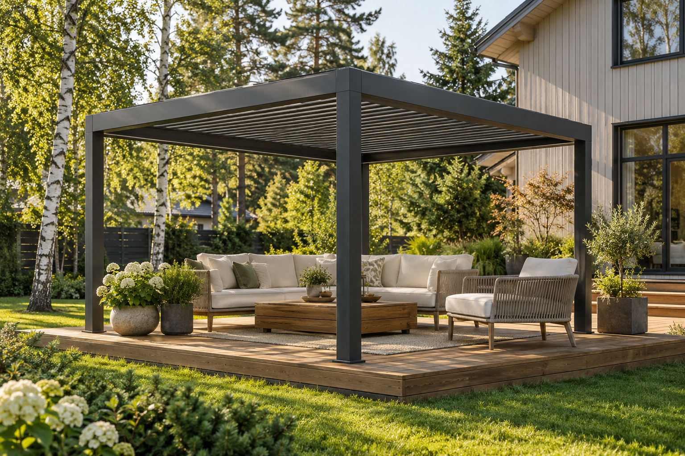
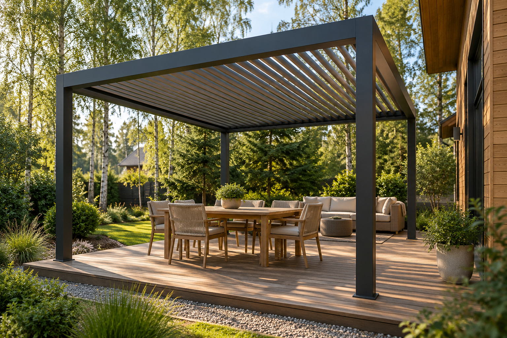

# СВОЙ ДОМ — предпросмотр

Обновление 11 октября 2026: добавлены два проекта домов и фотографии двух бань. Ниже сначала показаны каталоги, затем главная и визуализации пергол.

Прокрутите страницу вниз, чтобы увидеть изображения. Это снимки разработанного сайта для согласования дизайна и наполнения. [Открыть PDF со всеми девятью страницами](svoi-dom-preview.pdf).

[Готовый запрос поставщику — русский и английский](SUPPLIER-REQUEST.md). Здесь перечислены сведения для заполнения четырёх карточек.

[Что осталось до запуска сайта](LAUNCH-CHECKLIST.md) — готовые разделы, недостающие сведения и дальнейшие шаги.

[Проекты политики и согласия](LEGAL-DRAFTS.md) — внесены реквизиты ИП, максимум 12 месяцев для заявок без договора и схема хранения в России. Фактические настройки ещё предстоит проверить.

## Модульные дома

Две карточки для сезонного проживания — весна, лето и осень. Предварительная цена каждого дома: от 3 000 000 ₽. В подробных карточках есть внешний вид, интерьер и санузел из присланных материалов.

## Модульные бани

Две самостоятельные модели для круглогодичного использования. Предварительная цена каждой бани: от 1 400 000 ₽.

Цены включают изделие в базовой комплектации и доставку до Череповца. Доставка на участок, основание, монтаж и подключения рассчитываются отдельно. Распределение фотографий по четырём моделям подтверждено владельцем. Названия «Проект 1» и «Проект 2» рабочие; размеры, планировки и состав комплектации согласуются.

## Подробные карточки

Нажмите на нужный проект, чтобы посмотреть снимок всей страницы:

- [Дом «Проект 1» — внешний вид, интерьер и санузел](house-project-1.jpg)
- [Дом «Проект 2» — внешний вид, интерьер и санузел](house-project-2.jpg)
- [Баня «Проект 1»](bath-project-1.jpg)
- [Баня «Проект 2»](bath-project-2.jpg)
- [Каталог домов на телефоне](houses-mobile.jpg)
- [Карточка дома «Проект 1» на телефоне](house-project-1-mobile.jpg)

## Главная страница

Строительство, модульная продукция, выставочная площадка и заявки.

## Пергола: зона отдыха

Визуализация возможного оформления зоны отдыха. Характеристики и комплектация реального изделия требуют подтверждения.

## Пергола: обеденная зона

Визуализация возможного оформления зоны отдыха.

Интерактивная версия сайта подготовлена в рабочей среде. Для открытия посетителям её предстоит развернуть на сервере владельца после подготовки товарных сведений, документов и каналов обработки заявок.
